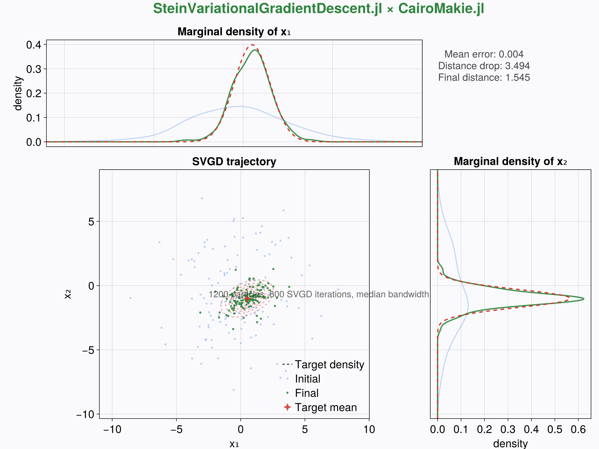

# SteinVariationalGradientDescent.jl

`SteinVariationalGradientDescent.jl` implements Stein Variational Gradient Descent for differentiable
target densities. It focuses on type-stable kernels, analytic Gaussian updates, and integrates tightly
with the `Kernelregression` module from [`SimpleKernelRegression.jl`](https://github.com/NilsWildt/SimpleKernelRegression.jl). A short alias `SVGD` is exported for convenience.

## Highlights

- Type-stable particle updates with a pure functional driver.
- Median heuristic bandwidth selection paired with progress logging.
- Built on `Kernelregression` kernels for distances and diagnostics.

## Installation

Add the package to an active environment either in development mode

```julia
] dev https://github.com/<user>/SteinVariationalGradientDescent.jl
```

## Quick start

```julia
using Random
using SimpleKernelRegression
using SteinVariationalGradientDescent

rng = Random.MersenneTwister(2024)
μ = [0.5, -1.0]
Σ = [1.0 0.3; 0.3 0.5]

∇log_p(x) = -(Σ \ (x .- μ))
inits = randn(rng, 128, 2)

kernel = SimpleKernelRegression.Gaussian(1.0)
result = svgd(∇log_p, inits;
              n_iter = 450,
              stepsize = 0.25,
              bandwidth_method = :median,
              kernel = kernel,
              progress = true)

result.particles      # final particle cloud (128 × 2)
result.distances      # diagnostic mean pairwise distances per iteration
```

`result.distances` tracks the mean pairwise distance each iteration; plateauing traces usually signal convergence.

## Testing

The package ships with a `TestItems.jl` suite that exercises convergence properties, floating-point
stability, and the median bandwidth heuristic. Run it in a Julia session via

```julia
] test SteinVariationalGradientDescent
```

## Documentation

The `docs/` folder contains a `Documenter.jl` setup. Build the documentation locally with

```julia
julia --project=docs docs/make.jl
```

which renders the manual to `docs/build`.

## Example notebooks & scripts

An executable example lives in `examples/gaussian_demo.jl`, recreating the Gaussian test case and saving
`gaussian_svgd.png` via `CairoMakie.jl`. The figure overlays the initial and converged particle clouds with
Gaussian target contours and supplements them with marginal density panels.



Regenerate the graphic with

```bash
julia --project=examples examples/gaussian_demo.jl
```

## Limitations 

Be aware about recent publications showing variance collapse in high dimensions, see 

* Ba, Jimmy, et al. "Understanding the variance collapse of SVGD in high dimensions." *International Conference on Learning Representations*. 2021.

## References

- Q. Liu and D. Wang (2016), *Stein Variational Gradient Descent: A General Purpose Bayesian Inference Algorithm*, NeurIPS.
- R. Shu, X. Meng, and S. Ermon (2018), *Amortized Inference Regularization*, NeurIPS.
